<h1 align="center">Isoline</h1>

Patterns, gradients, palettes and UI kits, made in one browser tab.

  

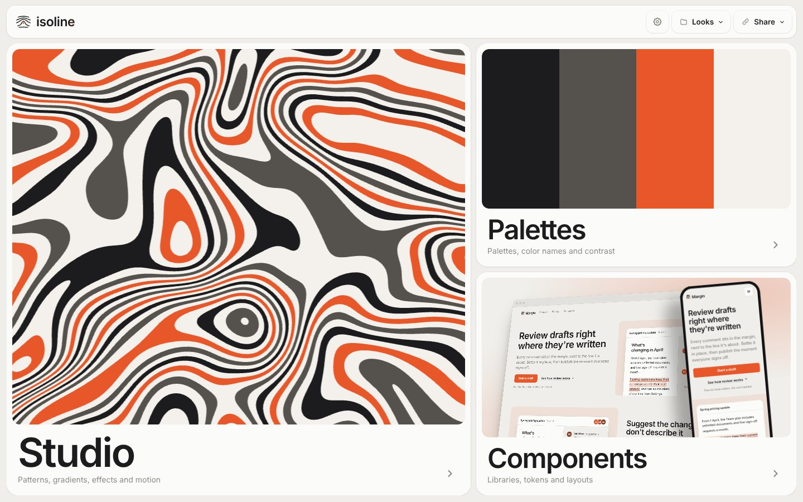

## Three tools to kickstart your designs

| Studio | Palettes | Components |
| :-- | :-- | :-- |
| 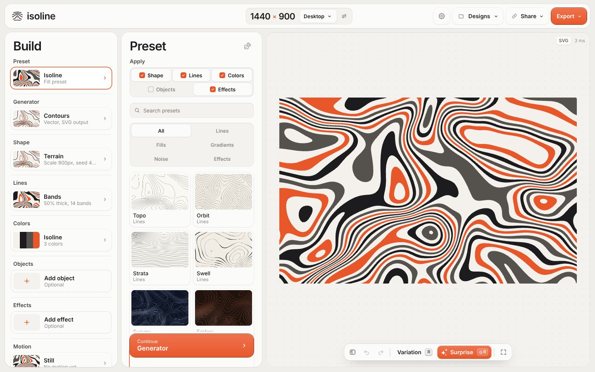 | 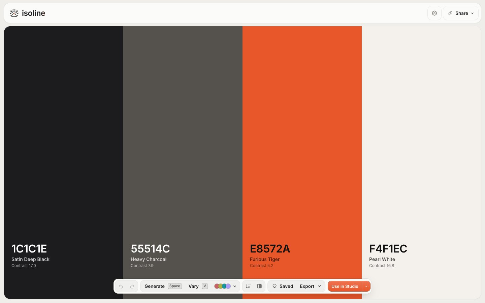 | 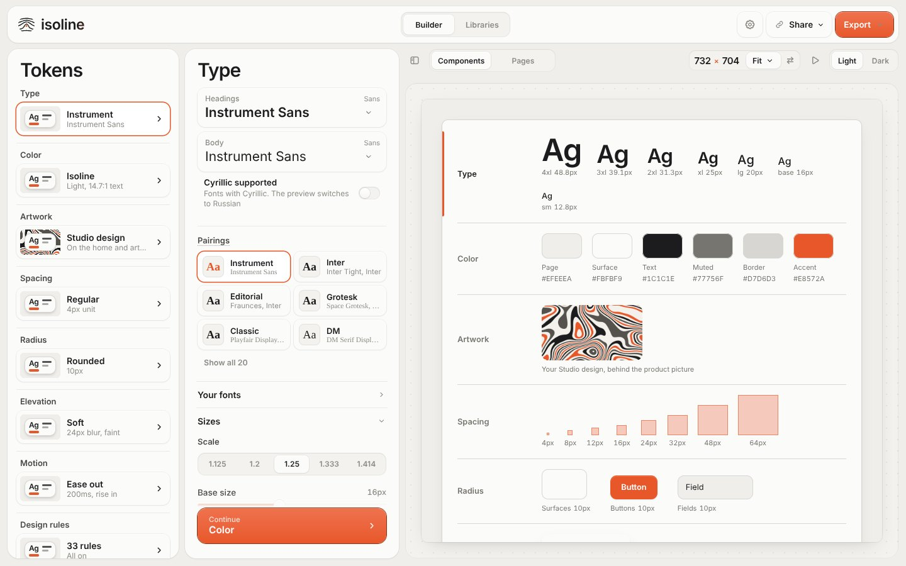 |
| Instantly make beautiful backgrounds, and edit them in any way you want. And you can animate it in one click! | Can't think of a color scheme for your next design? We got you covered. Now with inf% less ads!1!1 (looking at you Coolors). | Want to turn your background and colors into a ready-to-go library? No? Well, you can, or pick a ready design system! |

## Made in the Studio

  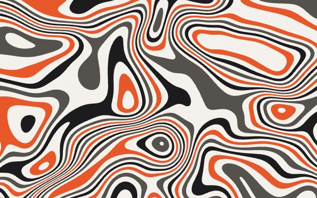
  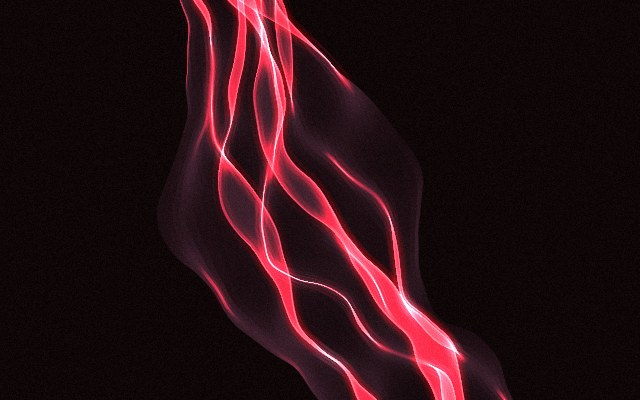
  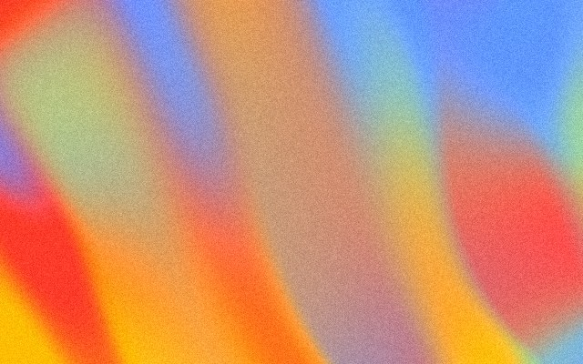
  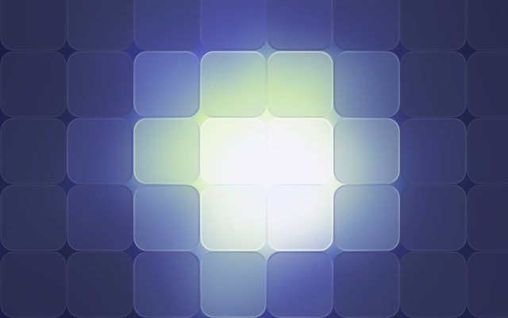
  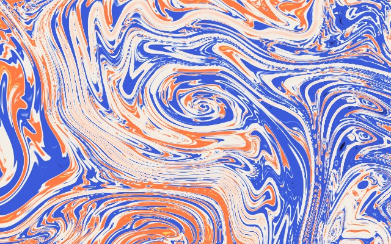
  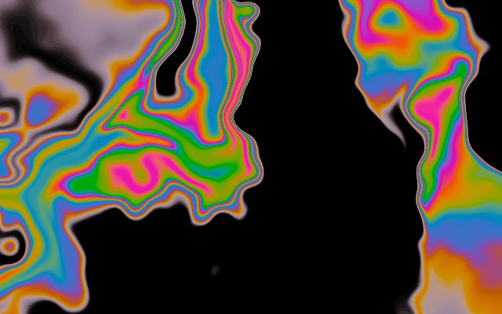
  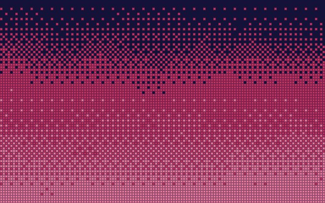
  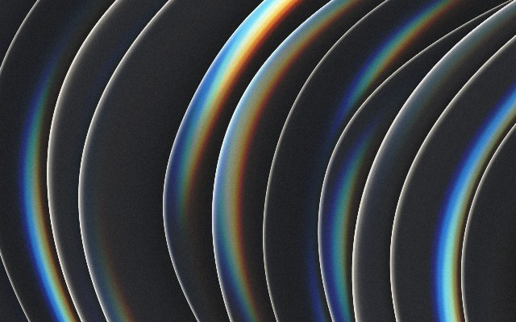
  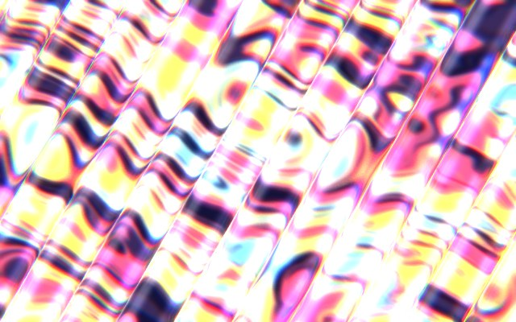

## And a few more things

- Stack up to 50 effects: liquify, glitch, distort, put some glass on it, make it melt together, do whatever! More than a bazillion something combinations await!
- A tour to get you started super quick.
- Should work on everything, except for Nokias or something (even on foldables!).
- English 🇺🇸, Russian 🇷🇺, other languages maybe later?
- Save, load and share designs with your friends.
- Internal API and onboarding for agents if ur too lazy.
